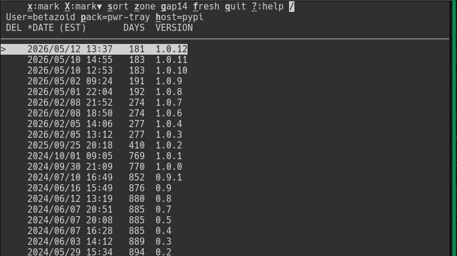

# pypi-cleanup-tui

A thin, visual skin over [`pypi-cleanup`](https://pypi.org/project/pypi-cleanup/), which performs the actual deletion. Use the TUI to cull versions by hand with the survivors in view; use `pypi-cleanup` directly when reusable rules (`.*rc\d+`, keep-newest, before-a-date) or automation across many packages fit better.



## Installation

```bash
pipx install -f pypi-cleanup-tui   # install or refresh; -f makes one command do both
pipx install -f pypi-cleanup       # the tool the TUI hands the deletion to
```

Add these to your shell profile so a run asks fewer questions:

```bash
export PYPI_CLEANUP_PASSWORD='...'           # assumes the same password on pypi and test
export PYPI_CLEANUP_TOTP_SECRET4PYPI='...'   # authenticator secret for pypi.org
export PYPI_CLEANUP_TOTP_SECRET4TEST='...'   # for test.pypi.org; cannot be the same
```

Python 3.11 or newer. The TUI exposes only part of `pypi-cleanup`; a read-only run browses without it installed.

## Usage

```bash
pypi-cleanup-tui --user alice pack1,pack2 pack3
```

The first name opens in the table; the rest wait for `p` and are remembered. Package arguments are cumulative: this run's names go in front of the remembered list. Options persist in `~/.config/pypi-cleanup-tui/config.ini`, so a bare `pypi-cleanup-tui` restarts your last session.

`-u`/`--user` names the account. `--totp-method` chooses how the authenticator code is supplied. `--totp-dump` prints the current codes for comparison. `--read-only` browses without `d`. `-h` lists every option and the remembered values.

### A typical session

1. Start with one or more packages, e.g. `pypi-cleanup-tui pack1`.
2. Mark releases to delete: `x` marks the picked release, `X` marks it and every release below it; `u`/`U` unmark. `g` unmarks releases superseded too soon, and `/` limits marking to the visible rows.
3. Press `d`. A `pypi-cleanup` dry run runs first, then a second confirmation before the actual deletion.
4. Press `h` to swap to the other index, then mark and press `d` there too.
5. Press `p` for the next package, or `P` to open the package list and prune remembered names. Highlight the next package and press `ESC` to open it; repeat.
6. Press `q` to quit.

### Help screen

`?` is the full reference: every key, what each screen offers, and the saved options with the file they came from. `ESC` returns to the screen that opened it. `T` opens the theme picker; `t` cycles palettes, and `mono` turns color off.

### Load states and refetch

The table keeps each `(package, host)` pair's rows and marks for the whole run. A refresh that fails after a successful load keeps the old table and flags `STALE [12m]` in the header; `f` refetches. If the whole history is marked, the newest release is unmarked first, because `pypi-cleanup` will not remove every release. After a deletion the TUI refetches; a lagging CDN can keep `STALE` until `f` sees a fresh list.

## Troubleshooting and Precautions
* **Stale Version Lists**: the TUI asks the index not to cache, but a proxy or corporate network can still serve old data for up to 15 minutes. `f` refetches; after a deletion the header shows `STALE [12m]` until the index stops listing the deleted versions. A failed refresh also leaves the old table marked `STALE`, with the alert explaining the failure.
* **Authenticator/TOTP (Time-based One-time Password) Failures**: if the TUI's codes are rejected, check the machine's clock is NTP-synced and compare the dumped codes with your authenticator app. If the times agree but the codes do not, recheck the secret.
* **General Credential Failures**: If `pypi-cleanup` fails with an authentication or unrecognized device error (initially or later), log into `pypi.org` and/or `test.pypi.org` from a browser on this same machine and choose to remember the device for 30 days.

## License

This project is licensed under the MIT License. See the [LICENSE](LICENSE) file for details.
