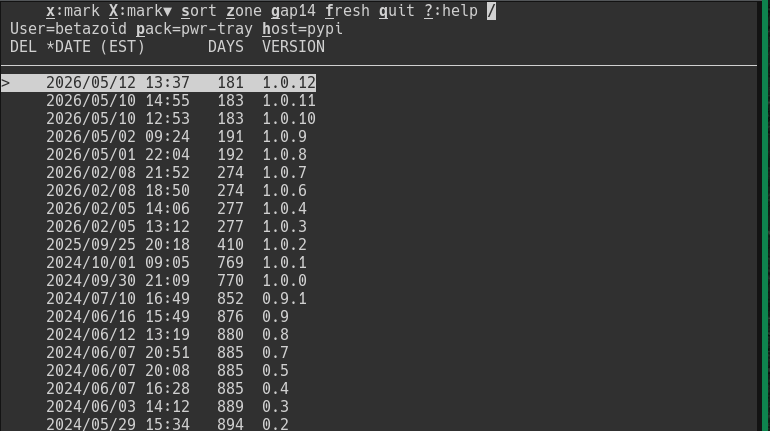

# pypi-cleanup-tui

A thin, visual skin over [`pypi-cleanup`](https://pypi.org/project/pypi-cleanup/), which performs the actual deletion. Consider using:

- this TUI to cull per-version and visually: selecting by hand, with the survivors in view;
- `pypi-cleanup` directly when cull rules are expressible and reusable (`.*rc\d+`, keep-newest, before-a-date), especially for automation across many packages.



## Features

- A package's whole history in one table, with upload date and age in calendar days, so a stale release is visible at a glance.
- Mark with `x`/`X`, clear with `u`/`U` -- a selection you can see, with no pattern to get wrong.
- A stability gap (`g`) unmarks the releases a newer one superseded too soon: what stays is what people actually installed.
- Search (`/`) over the versions; while a pattern is in force, the marking keys touch only the visible rows.
- Move between packages with `p`/`P`, between indexes with `h`, sort with `s`, change the date zone with `z`.
- Every deletion is a dry run first, with the command and its report shown before a second confirmation; a read-only run browses with no delete key.

## Installation

```bash
pipx install -f pypi-cleanup-tui   # install or refresh; -f makes one command do both
pipx install -f pypi-cleanup       # the tool the TUI hands the deletion to
```

> **Note:** pipx gives the TUI its own environment; the package needs Python 3.11 or newer. The TUI exposes only part of [`pypi-cleanup`](https://pypi.org/project/pypi-cleanup/); run that tool directly for anything it lacks, and a read-only run browses without it installed.

## Usage

### Command line

```bash
pypi-cleanup-tui --user alice pack1,pack2 pack3
```

The first name is the package the table opens; the rest is kept for `p` and for the next run. Package arguments are cumulative: a run puts its names in front of the remembered list and drops duplicates.

| Featured Option | Meaning |
| --- | ------- |
| `-u`, `--user` | the PyPI account, kept for the cleanup step; remembered |
| `--totp-method` | how the authenticator code is supplied; explained below; remembered |
| `--totp-dump` | for troubleshooting, show the current authenticator codes for comparison; `Ctrl-C` exits |
| `-h`, `--help` | see every option and the remembered values |

### Main screen

| Key | Action |
| --- | ------ |
| `q` | quit |
| `?` | open the help screen; `ESC` returns to the screen that opened it |
| `/` | open the incremental search; `ENTER` closes it, `ESC` restores the pattern |
| `T` | open the THEMES screen (also from the help screen); `ESC` returns to the screen that opened it |
| `t` | cycle the color theme (THEMES and help screens; `mono` turns color off) |
| `p` | show the next package in the list and reload |
| `P` | open the package list |
| `h` | switch between pypi.org and test.pypi.org and reload |
| `f` | refetch the package; marks stay, and `STALE` clears once the index catches up |
| `x` | mark the picked release for deletion, then step down |
| `X` | mark the picked release and every release below it, then step up (unmarked row only) |
| `u` | unmark the picked release, then step down |
| `U` | unmark the picked release and every release below it, then step up (marked row only) |
| `z` | switch the `DATE` column between UTC and the local time zone (also on the help screen) |
| `s` | change the sort order |
| `d` | leave the table, run a `pypi-cleanup` dry run, then the deletion after a second confirmation |
| `g` | apply the stability gap on the table; on the help screen, rotate the gap instead |

The second header line names the run: `User=...`, `[p]ack=...` and `[h]ost=...`; `host` is the index key, not a domain. A bold `STALE` follows `host=` while the index has not caught up with a deletion (see below).

Marked releases take `✘` in `DEL` and dim; the releases that will be kept stay in the success color. `T` lists the palettes; its `mono` entry turns color off.

The column titles are the third header line, with a `*` on the sorted column and the zone named in `DATE`. A key block that does not apply is blanked, so nothing to its right moves:

```text
x:mark X:mark▼ sort zone gap30 fresh quit ?:help /     nothing marked, unmarked row
del unmark Unmark▼ sort zone gap30 fresh quit ?:help /     marked, pick on a marked row
R/O unmark Unmark▼ sort zone gap30 fresh quit ?:help /     read-only, d never offered
```

* An unmarked row offers `x`/`X`; a marked row offers `u`/`U`.
* `d` leads once something is marked and no pattern is filtering; a read-only run shows `R/O` instead.
* `f` refetches the package: marks follow the versions the index still lists, and `STALE` clears once a deletion is confirmed.

### Search and the stability gap

* `/` filters the version column with a case-insensitive regular expression; `ENTER` closes it, `ESC` restores the previous text, and a closed pattern limits `x`, `X`, `u` and `U` to the visible rows. An empty or invalid pattern leaves the table unfiltered.
* On the help screen `g` picks the stability gap; on the table it applies it, unmarking every marked release that a newer release superseded within the gap. Days are calendar days in the zone `z` shows, the newest release counts as stable, and the choice is remembered.

### Package screen

`P` opens the package list, whose rows are also what `p` rotates through:

```text
PACKAGES  x:remove ESC:open ?:help
  PACKAGE  VERs  DELs
✓ alpha       3     0
✓ beta        2     0
  gamma       -     -
```
* Each row shows whether the package was visited (`✓`), its name, its last known version count and this run's delete count.
* `ESC` opens the highlighted package in the table.
* `x` removes the highlighted package from the TUI's list, not from the index.

### Running `pypi-cleanup`

A normal run first checks that [`pypi-cleanup`](https://pypi.org/project/pypi-cleanup/), which performs the actual deletion, is installed, and stops with a hint when it is missing. A read-only run skips that check and shows `R/O` where `del` would be.

Pressing `d` leaves the table for the bare terminal, runs a `--query-only` dry run, then asks again before the `--do-it` deletion. Note that:
- Each question takes `yes`, `no`, or a bare `ENTER` for the safe answer (yes to the dry run, no to the deletion).
- The printed command is a description, not meant to be copied; a long version pattern is broken after its `|` alternations.
- When a scoped password supplies a value, a line above the command names the mapping, never the value.
- If you provide `$PYPI_CLEANUP_TOTP_SECRET`, then `--totp-method` chooses how this TUI assists providing the 6-digit code:
  - **`expect`** (default) runs `pypi-cleanup` under `pexpect`; you answer prompts until the "Authentication code:" prompt where you press `Ctrl+]` for the TUI to answer.
  - **`auto`** provides the code w/o manual intervention; you must set `$PYPI_CLEANUP_PASSWORD`, too.
  - **`print`** shows the code and its remaining lifetime above each run; you type it at the prompt (be quick or it may expire).
  - **`off`** leaves answering entirely to you; same behavior as no `$PYPI_CLEANUP_TOTP_SECRET`.

A successful deletion hides the deleted versions and and re-fetches the version list. If the fetched list has deleted versions (its CDN can lag), a bold `STALE` appears in the header until `f` finds the a new version list credibly up-to-date; switching the packages or host drops the `STALE` indicator.

> **Hints for credentials (to reduce interactive prompts)**
>
> * Set `$PYPI_CLEANUP_USER4PYPI` and `$PYPI_CLEANUP_USER4TEST` to override the run's user per index (only needed if the two user names differ).
> * Set `$PYPI_CLEANUP_PASSWORD` to your account's login password to avoid the `pypi-cleanup` password prompt.
>   * If the pypi and test passwords differ, scope them by appending `4PYPI` or `4TEST` to the names, and this TUI overrides `$PYPI_CLEANUP_PASSWORD` according to scope.
> * Set `$PYPI_CLEANUP_TOTP_SECRET` (and/or its scoped forms) to let this TUI supply the 6-digit code per the `--totp-method`.

### Options are remembered

Your package list, sort order, date zone, gap, theme, user, index and TOTP method persist in `~/.config/pypi-cleanup-tui/config.ini`, so a bare `pypi-cleanup-tui` starts with your previous options. Read-only mode is never remembered.

```bash
pypi-cleanup-tui newpack   # newpack, then the stored names
pypi-cleanup-tui pack2     # an already stored name keeps its position
```

`?` lists the saved options and the file they came from.

## Troubleshooting and Precautions
* **Stale Version Lists**: the TUI asks the index not to cache, but a proxy or corporate network can still serve old data for up to 15 minutes. `f` refetches; after a deletion the header shows `STALE` until the index stops listing the deleted versions.
* **Authenticator/TOTP (Time-based One-time Password) Failures**: if the TUI's codes are rejected, check the machine's clock is NTP-synced and compare the dumped codes with your authenticator app. If the times agree but the codes do not, recheck the secret.
* **General Credential Failures**: If `pypi-cleanup` fails with an authentication or unrecognized device error (initially or later), log into `pypi.org` and/or `test.pypi.org` from a browser on this same machine and choose to remember the device for 30 days.

## License

This project is licensed under the MIT License. See the [LICENSE](LICENSE) file for details.
